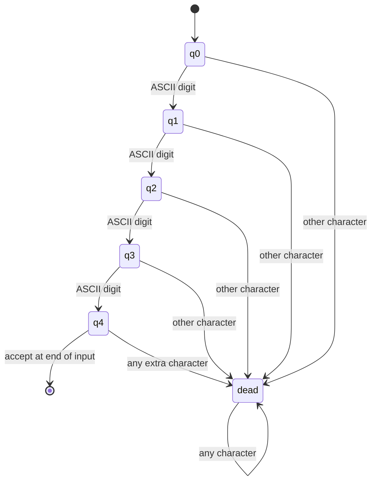
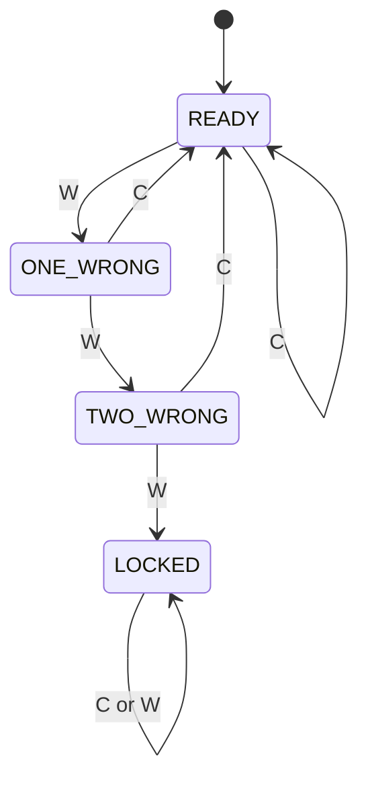

# Finite Automata for Real-Time Input Validation

An individual Formal Language and Automata project demonstrating DFA and NFA models for password rules, email-format checks, and four-digit ATM PIN formatting. A separate session DFA models a three-consecutive-failure lockout policy. The command-line program reports acceptance and prints the state reached after each character; a standalone browser demo provides an interactive view.

## Models at a glance

| Application | Automaton | States / demonstration |
|---|---|---|
| ATM PIN format | DFA | 6 states: five digit-count states and a rejecting sink |
| Password policy | Product of five component DFAs | 144 possible product states; 112 reachable under the defined input classes |
| Email-format subset | Hand-specified NFA → subset DFA → minimized DFA | 10 NFA states → 10 reachable subset states (including the empty set) → 8 minimized states |
| Consecutive-failure lockout | Event DFA over correct/wrong attempts | 4 states, including an absorbing locked state |

The project describes each input language explicitly, shows how its automaton processes a string, and includes tests that compare related constructions. State counts refer to these implementation models and their declared alphabets.

## Run it

Requires Python 3.10 or newer. The recognizers and command-line demo use only the Python standard library.

```bash
python -m task2
python -m task2 --stats
python -m task2 --limits
python -m unittest discover -s tests -v
```

The menu runs each validator and prints its state trace. For example, choose the email option and enter `student123@yahoo.in` to see the NFA's active states after each character. The statistics option reports automaton sizes; the limits option prints what format validation does not establish.

Open [`docs/index.html`](docs/index.html) for the browser demo. It runs locally without a server or external packages. The implementation and report are in [`task2/`](task2/) and [`docs/design.md`](docs/design.md).

## 1. ATM PIN format

The PIN DFA accepts exactly four ASCII digits. Its states count digits read so far; any non-digit or any extra character enters the rejecting sink.



The separate lockout DFA reads events `C` (correct attempt) and `W` (wrong attempt). A correct attempt resets the consecutive-failure count; the third consecutive wrong attempt enters the locked state.



## 2. Password policy

The policy requires at least eight characters, with at least one ASCII uppercase letter, one ASCII lowercase letter, one ASCII digit, and one ASCII non-alphanumeric character. The implementation expresses this as a direct product of five small DFAs: a capped length counter and four category-seen flags. A product state is `(length, uppercase_seen, lowercase_seen, digit_seen, special_seen)`.

The product has at most `9 × 2⁴ = 144` states. Some combinations cannot occur before enough characters have been read, leaving 112 reachable states over the declared input classes. The accepted language has no maximum length; spaces count as ASCII non-alphanumeric characters in this stated policy.

## 3. Email-format subset

This recognizer accepts a deliberately limited ASCII syntax, not every address allowed by the email standards:

```text
local   = alnum+ ( [._-] alnum+ )*
label   = alnum+ ( '-' alnum+ )*
domain  = label ( '.' label )* '.' tld
tld     = letter{2,}
address = local '@' domain
```

At each domain dot, the NFA can either continue with another domain label or guess that the final suffix begins there. Subset construction creates a DFA from the reachable NFA-state sets; partition refinement minimizes that DFA. The report includes the transition table and the meaning of each subset state.

## Syntax versus real-world checks

These automata answer whether a string follows the format defined here. They do not establish that an email mailbox exists, that a PIN belongs to a bank account, or that a password is secure or absent from breach lists. The session DFA illustrates an event policy; it is not connected to a banking system.

## Project layout

```text
task2/       reusable DFA/NFA engine, validators, and session DFA
tests/       standard-library tests and bounded exhaustive NFA/DFA comparisons
docs/        report, Mermaid diagrams, JSON model manifest, browser demo
```

See [`docs/design.md`](docs/design.md) for formal definitions, transition details, examples, test scope, derivations, and report-ready discussion. The original assignment PDF was not attached to the referenced conversation, so check the stated policy against your course brief before submitting.

Repository: https://github.com/Saffhrin/FLA-Task2-Finite-Automata
