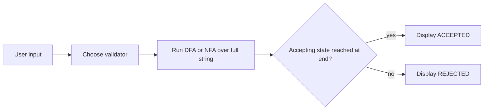
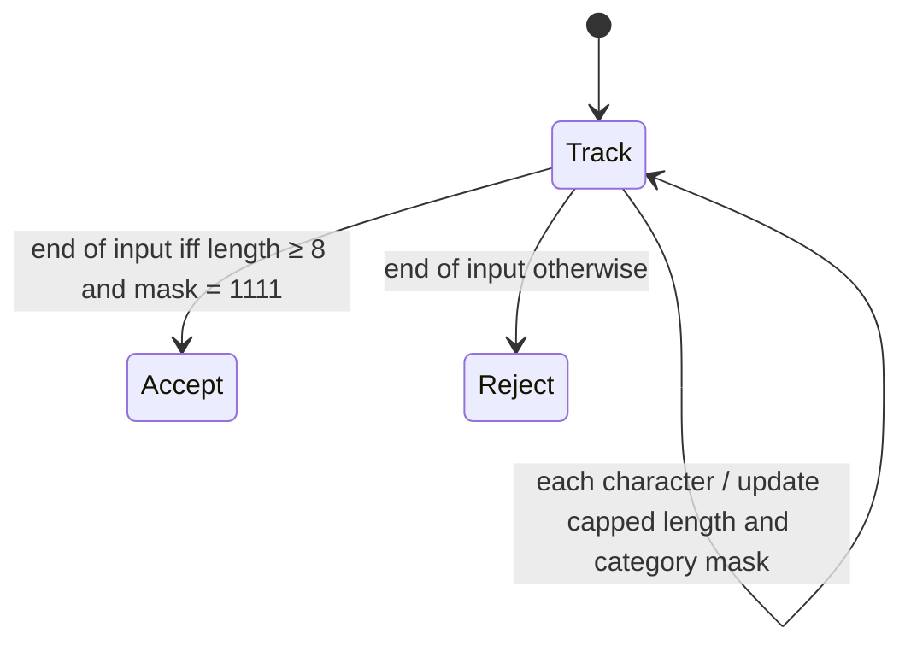
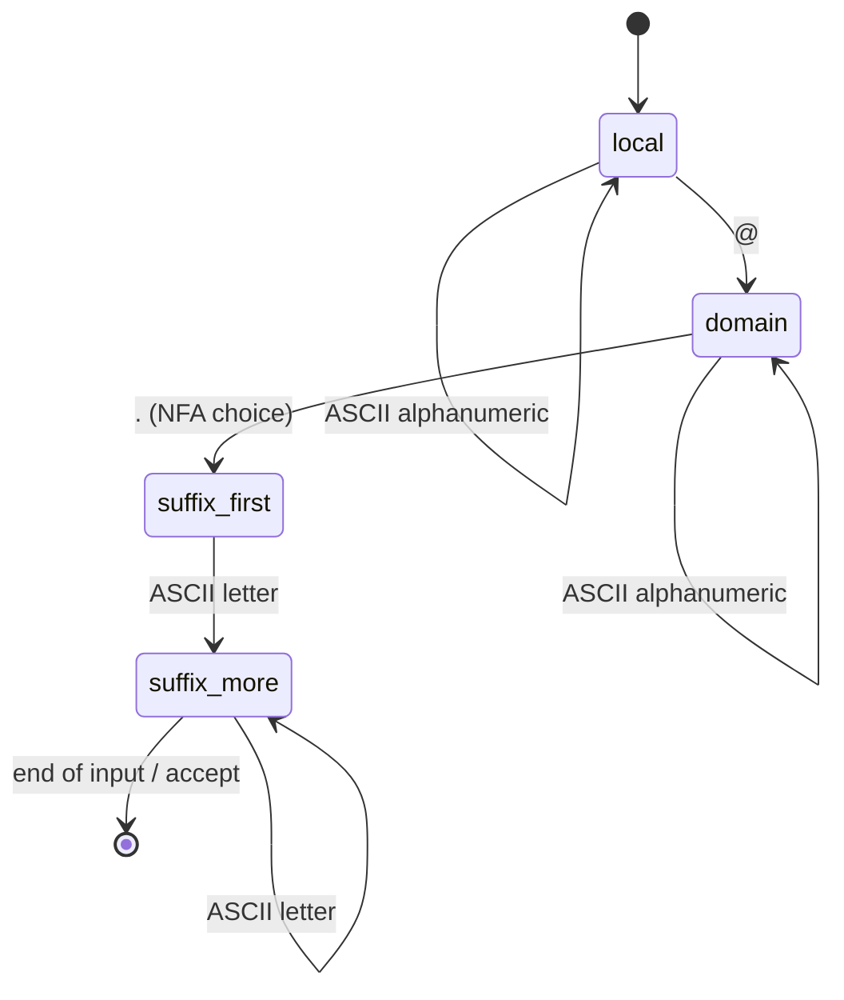
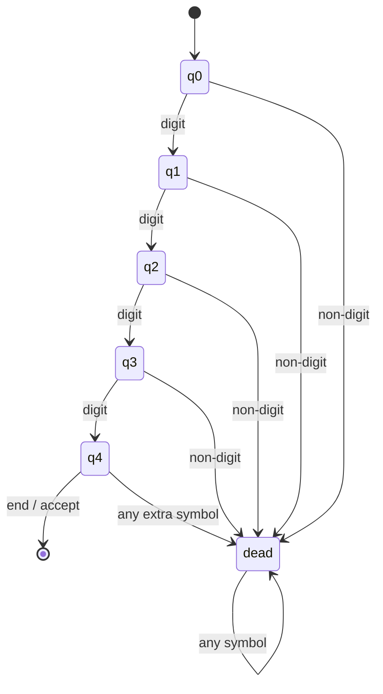

# Task 2 report content and formal design

## Title

**Designing Finite Automata for Real-Time Input Validation Systems**

## Abstract

This project models three input-format checks with finite automata: password policy, a limited email syntax, and a four-digit PIN. A password DFA tracks a bounded length and four requirement flags; a PIN DFA counts digits; an email NFA recognizes a stated subset of address strings. A small Python menu makes the recognizers usable interactively. The models demonstrate language recognition and do not authenticate users or certify security.

## Problem, scope, and objectives

Input validation rejects strings that do not follow a declared format. The objective is to specify each language precisely, construct a finite state model, implement it, and demonstrate accepted and rejected inputs. “Real-time” here means immediate validation after the entered string is processed; it does not imply a production authentication service.

## Formal models

### Validation workflow

### Password policy (DFA)

Alphabet: ASCII characters. For the policy categories, characters are mapped to uppercase, lowercase, digit, or special (ASCII non-alphanumeric). Let a state be `(n, m)`, where `n ∈ {0,…,8}` is the length capped at 8 and `m ∈ {0,…,15}` is a four-bit mask for the categories observed. The transition increments `n` up to 8 and sets the corresponding category bit. Start state `(0,0)`; accepting states are exactly `(8,15)`. This finite product DFA accepts strings of at least eight characters containing each category. Non-ASCII characters do not satisfy any category; a non-ASCII symbol still counts toward total length.

The shown control state is an abstraction; the full DFA state is the pair `(n,m)`, up to 144 possible pairs.

For the password product DFA, every input symbol increments `n` up to 8. Its category bit is `1` for uppercase, `2` for lowercase, `4` for ASCII digit, and `8` for ASCII non-alphanumeric; the transition ORs that bit into `m`. All other bits are unchanged.

### Email syntax subset (NFA)

Language: `ALNUM+ @ ALNUM+ . LETTER{2,}` over ASCII, where the NFA may choose a dot in the domain as the boundary to the final alphabetic suffix. Start `local`; accepting state `suffix_more`. On `ALNUM`, `local` and `domain` loop; `local` goes to `domain` on `@`; `domain` loops on alphanumeric and may go to `suffix_first` on `.`; `suffix_first` requires a letter to enter `suffix_more`, which loops on letters. All unspecified transitions go to the empty state set. Acceptance requires at least one suffix letter after the first, so the TLD has length ≥2. This intentionally narrow subset excludes many legal addresses and does not assert mailbox existence.

| Current NFA state | Input class | Next state set |
|---|---|---|
| `local` | ASCII alphanumeric | `{local}` |
| `local` | `@` | `{domain}` |
| `domain` | ASCII alphanumeric | `{domain}` |
| `domain` | `.` | `{suffix_first}` |
| `suffix_first` | ASCII letter | `{suffix_more}` |
| `suffix_more` | ASCII letter | `{suffix_more}` |
| Any state | any other symbol | `∅` |

### ATM PIN (DFA)

Alphabet: ASCII digits plus all other characters. States `q0` through `q4` count digits consumed; `dead` is a sink. Each digit advances from `q0…q3`; any non-digit or any symbol after four digits enters `dead`. Only `q4` accepts at end of input. Thus the language is `{0,…,9}^4`.

| Current state | ASCII digit | Any other symbol |
|---|---|---|
| `q0` | `q1` | `dead` |
| `q1` | `q2` | `dead` |
| `q2` | `q3` | `dead` |
| `q3` | `q4` | `dead` |
| `q4` | `dead` | `dead` |
| `dead` | `dead` | `dead` |

## Examples and results

| Validator | Accepted examples | Rejected examples |
|---|---|---|
| Password | `Abcdef1!`, `Stronger9#word`, `A1aaaaa!`, `Qwerty7$`, `Passcode2@` | `Ab1!xyz`, `abcdefgh1!`, `ABCDEFGH1!`, `Abcdefgh!`, `Abcdefg1` |
| Email subset | `user@gmail.com`, `student123@yahoo.in`, `a@b.co`, `firstlast@subexample.org`, `x@y.ab` | `@gmail.com`, `user@gmail`, `user@.com`, `user@domain.c`, `user@@domain.com` |
| PIN | `1234`, `0000`, `9087`, `5678`, `2468` | `123`, `12345`, `12A4`, `１２３４`, empty string |

## Implementation and tests

The code in `task2/` provides reusable DFA/NFA runners and three recognizers. The CLI is launched with `python -m task2`. `tests/test_validators.py` gives five or more examples in each accepted/rejected group; run them with `python -m unittest discover -s tests -v`.

## Limitations and conclusion

Password acceptance only checks the declared character policy; it does not estimate entropy or check breached-password lists. Email syntax is a deliberately defined subset and cannot verify a mailbox. PIN format recognition does not check a bank account, secret, retry counter, or card status. Within these boundaries, the project shows how DFA state tracks finite summaries and how an NFA accepts when any active path reaches a final state.

## References

1. J. E. Hopcroft, R. Motwani, and J. D. Ullman, *Introduction to Automata Theory, Languages, and Computation*, 3rd ed., Pearson, 2006.
2. Python Software Foundation, *Python 3 Documentation*, https://docs.python.org/3/.
