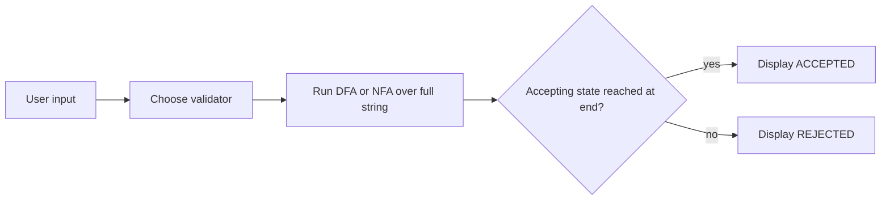
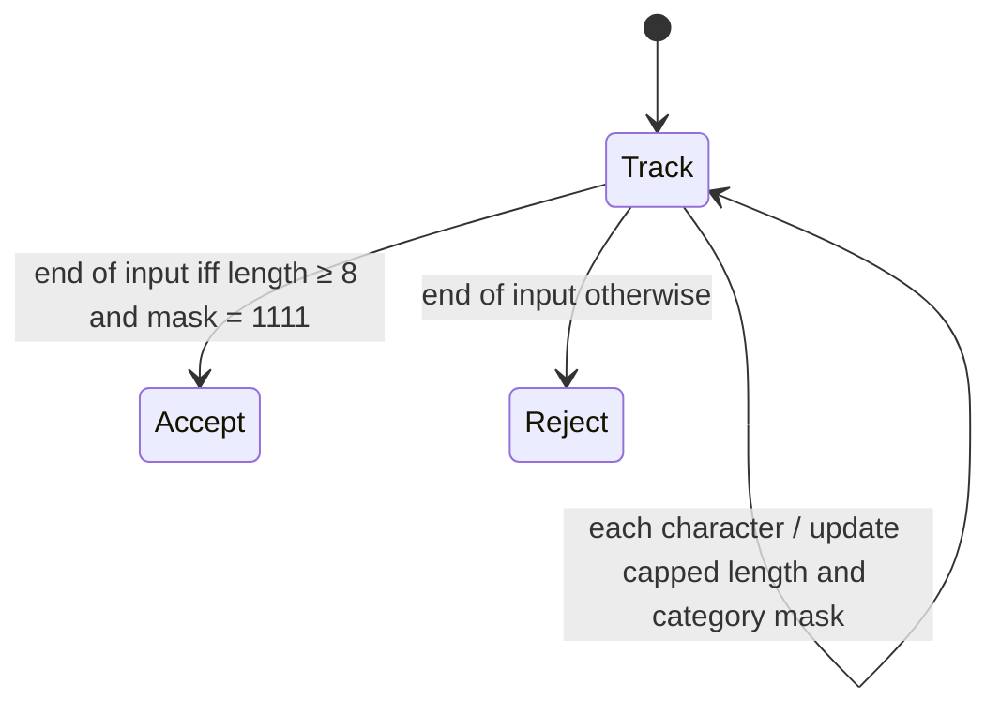
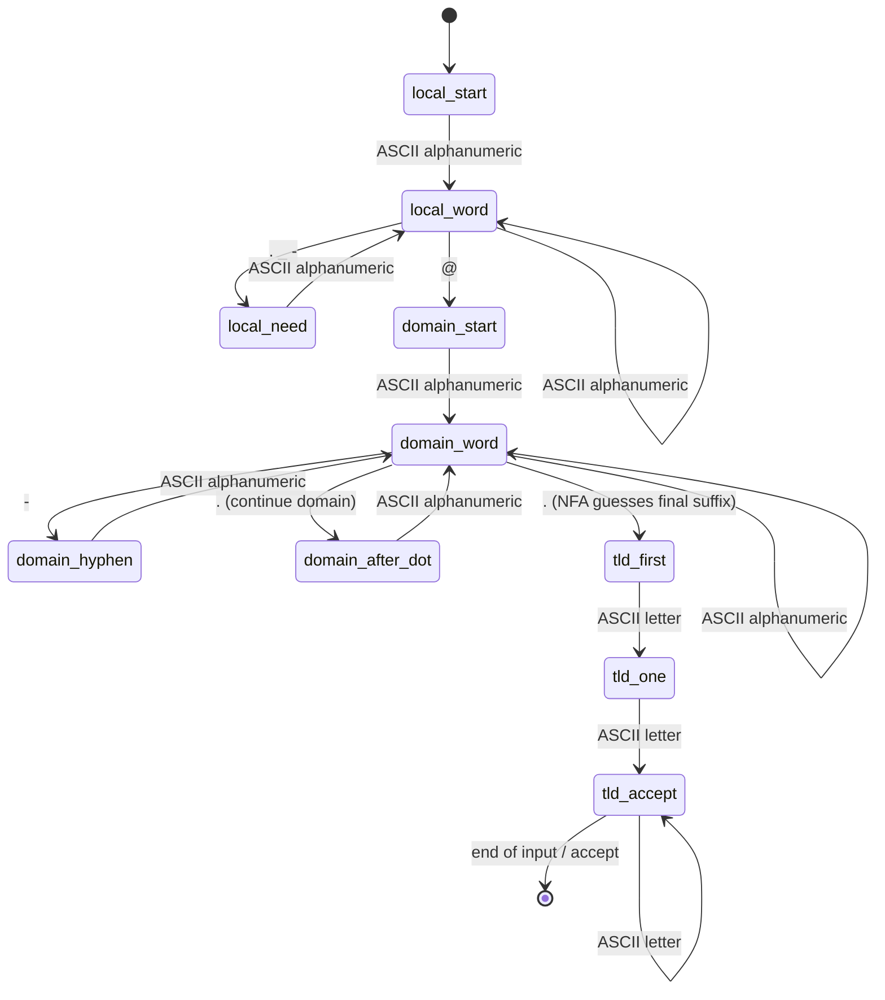
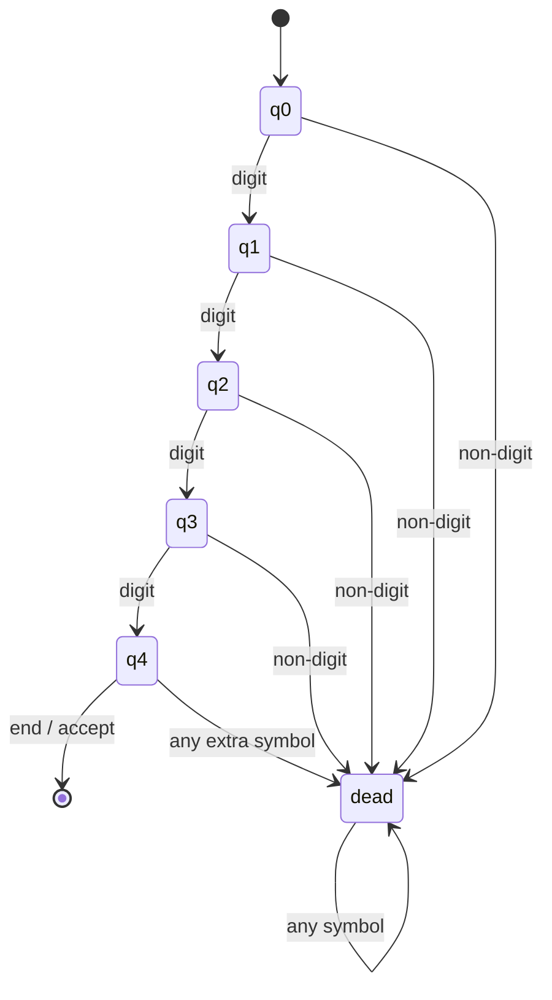

# Task 2 report content and formal design

## Title

**Designing Finite Automata for Real-Time Input Validation Systems**

## Abstract

This project models three input-format checks with finite automata: password policy, a limited email syntax, and a four-digit PIN. A password DFA tracks a bounded length and four requirement flags; a PIN DFA counts digits; an email NFA recognizes a stated subset of address strings. A small Python menu makes the recognizers usable interactively. The models demonstrate language recognition and do not authenticate users or certify security.

## Problem, scope, and objectives

Input validation rejects strings that do not follow a declared format. The objective is to specify each language precisely, construct a finite state model, implement it, and demonstrate accepted and rejected inputs. “Real-time” here means immediate validation after the entered string is processed; it does not imply a production authentication service.

## Formal models

### Validation workflow



### Password policy (DFA)

Alphabet: ASCII characters. For the policy categories, characters are mapped to uppercase, lowercase, digit, or special (ASCII non-alphanumeric). Let a state be `(n, m)`, where `n ∈ {0,…,8}` is the length capped at 8 and `m ∈ {0,…,15}` is a four-bit mask for the categories observed. The transition increments `n` up to 8 and sets the corresponding category bit. Start state `(0,0)`; accepting states are exactly `(8,15)`. This finite product DFA accepts strings of at least eight characters containing each category. Non-ASCII characters do not satisfy any category; a non-ASCII symbol still counts toward total length.



The shown control state is an abstraction; the full DFA state is the pair `(n,m)`, up to 144 possible pairs.

For the password product DFA, every input symbol increments `n` up to 8. Its category bit is `1` for uppercase, `2` for lowercase, `4` for ASCII digit, and `8` for ASCII non-alphanumeric; the transition ORs that bit into `m`. All other bits are unchanged.

### Email syntax subset (NFA → DFA → minimized DFA)

This recognizer intentionally accepts a practical ASCII subset, not the entire email standard:

```text
local  = alnum+ ( [._-] alnum+ )*
label  = alnum+ ( '-' alnum+ )*
domain = label ( '.' label )* '.' tld
tld    = letter{2,}
address = local '@' domain
```

The NFA requires an alphanumeric at the start and after every local/domain separator. At each domain dot following a complete label, it has two possible transitions: continue with another domain label, or guess that this dot starts the final suffix. The guessed path accepts only after two or more ASCII letters. Subset construction turns each active NFA-state set into one DFA state; partition refinement then merges equivalent DFA states. Tests compare all three recognizers on the same examples.



| Current NFA state | Input class | Next state set |
|---|---|---|
| `local_start` | ASCII alphanumeric | `{local_word}` |
| `local_word` | ASCII alphanumeric / local separator / `@` | `{local_word}` / `{local_need}` / `{domain_start}` |
| `domain_word` | ASCII alphanumeric / hyphen / dot | `{domain_word}` / `{domain_hyphen}` / `{domain_after_dot, tld_first}` |
| `domain_after_dot` | ASCII alphanumeric | `{domain_word}` |
| `tld_first` | ASCII letter | `{tld_one}` |
| `tld_one` | ASCII letter | `{tld_accept}` |
| `tld_accept` | ASCII letter | `{tld_accept}` |
| Any state | any other symbol | `∅` |

The NFA active-state set after a domain dot initially contains both `domain_after_dot` and `tld_first`. Subsequent input keeps valid alternatives alive, demonstrating NFA branching directly.

### ATM PIN (DFA)

Alphabet: ASCII digits plus all other characters. States `q0` through `q4` count digits consumed; `dead` is a sink. Each digit advances from `q0…q3`; any non-digit or any symbol after four digits enters `dead`. Only `q4` accepts at end of input. Thus the language is `{0,…,9}^4`.



| Current state | ASCII digit | Any other symbol |
|---|---|---|
| `q0` | `q1` | `dead` |
| `q1` | `q2` | `dead` |
| `q2` | `q3` | `dead` |
| `q3` | `q4` | `dead` |
| `q4` | `dead` | `dead` |
| `dead` | `dead` | `dead` |

## Examples and results

| Validator | Accepted examples | Rejected examples |
|---|---|---|
| Password | `Abcdef1!`, `Stronger9#word`, `A1aaaaa!`, `Qwerty7$`, `Passcode2@` | `Ab1!xyz`, `abcdefgh1!`, `ABCDEFGH1!`, `Abcdefgh!`, `Abcdefg1` |
| Email subset | `user@gmail.com`, `student123@yahoo.in`, `a@b.co`, `first.last@sub.example.org`, `x@y.ab` | `@gmail.com`, `user@gmail`, `user@.com`, `user@domain.c`, `user..name@domain.com` |
| PIN | `1234`, `0000`, `9087`, `5678`, `2468` | `123`, `12345`, `12A4`, `１２３４`, empty string |

## Implementation and tests

The code in `task2/` provides reusable DFA/NFA runners, NFA subset construction, DFA partition refinement, three validators, and a separate three-strike session DFA. The machine-readable model summary is `docs/automata.json`. The suite includes an exhaustive short-string comparison of the NFA, subset DFA, and minimized DFA over representative input classes. Launch `python -m task2` for the interactive CLI, `python -m task2 --stats` for state counts, or `python -m task2 --limits` for scope boundaries. Open `docs/index.html` locally for the browser demo. Run the standard-library tests with `python -m unittest discover -s tests -v`.

## Limitations and conclusion

Password acceptance only checks the declared character policy; it does not estimate entropy or check breached-password lists. Email syntax is a deliberately defined subset and cannot verify a mailbox. PIN format recognition does not check a bank account or secret. The independent session DFA demonstrates a three-failure lockout policy but is not integrated with a real bank. Within these boundaries, the project shows finite-state summaries, NFA branching, subset construction, and DFA minimization.

## References

1. J. E. Hopcroft, R. Motwani, and J. D. Ullman, *Introduction to Automata Theory, Languages, and Computation*, 3rd ed., Pearson, 2006.
2. Python Software Foundation, *Python 3 Documentation*, https://docs.python.org/3/.

